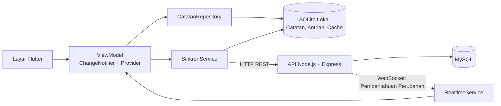
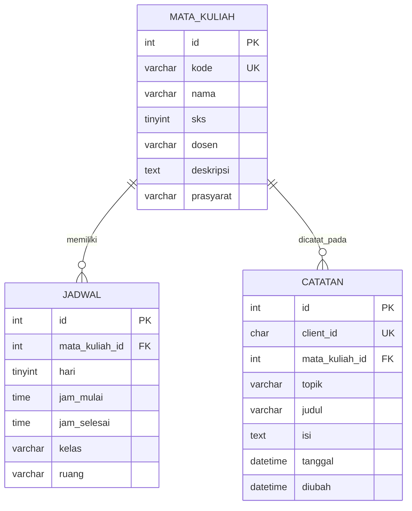

# StudyLog — Aplikasi Catatan Perkuliahan Berbasis Flutter Android

<p align="center">
  <strong>STUDYLOG</strong><br>
  Aplikasi Pencatatan Materi Perkuliahan Berbasis Android
</p>

StudyLog merupakan aplikasi pencatatan materi perkuliahan berbasis Android yang dikembangkan menggunakan **Flutter dan bahasa pemrograman Dart**. Aplikasi ini dirancang untuk membantu mahasiswa dalam mengelola catatan materi perkuliahan, informasi mata kuliah, jadwal pembelajaran, serta aktivitas akademik secara lebih terstruktur.

StudyLog menerapkan pendekatan *offline-first* dengan menggunakan SQLite sebagai penyimpanan lokal pada perangkat. Ketika koneksi tersedia, perubahan data dikirim melalui REST API berbasis Node.js dan disimpan ke database MySQL. Aplikasi juga memanfaatkan WebSocket untuk menerima pemberitahuan perubahan data dari perangkat lain secara real-time.

Proyek ini dikembangkan sebagai tugas Project-Based Learning (PjBL) mata kuliah **Pemrograman Aplikasi Bergerak**, Program Studi S-1 Informatika, Fakultas Ilmu Komputer, Universitas Mulia, dengan mengacu pada Workbook Praktikum 01 Flutter Android: StudyLog.

---

## 1. Informasi Proyek

| Informasi | Keterangan |
|---|---|
| Nama Aplikasi | StudyLog |
| Platform | Android |
| Framework | Flutter |
| Bahasa Pemrograman | Dart |
| State Management | Provider dan ChangeNotifier |
| Penyimpanan Lokal | SQLite (sqflite) |
| Backend | Node.js dan Express |
| Database Server | MySQL |
| Komunikasi | HTTP REST API dan WebSocket |
| Repository | [studylog-v2](https://github.com/2411009-yuda/studylog-v2) |
| Mata Kuliah | Pemrograman Aplikasi Bergerak |
| Program Studi | S-1 Informatika |
| Universitas | Universitas Mulia |
| Kelas | IFB5J |

### Anggota Kelompok

| Nama | NIM |
|---|---|
| Yuda Pratama | 2411009 |
| Wisnu Wardhana | 2411037 |
| Khoirul Ikwan | 2411020 |

---

## 2. Latar Belakang

Kegiatan perkuliahan menghasilkan berbagai materi, penjelasan, dan informasi yang perlu dicatat serta dikelola oleh mahasiswa. Catatan yang tersebar atau tidak tersimpan secara terstruktur dapat menyulitkan mahasiswa ketika ingin mencari kembali materi tertentu.

StudyLog dikembangkan sebagai solusi pencatatan materi perkuliahan melalui perangkat Android. Aplikasi menyediakan fungsi untuk membuat, membaca, mengubah, dan menghapus catatan yang dikaitkan dengan mata kuliah.

Berbeda dengan aplikasi yang sepenuhnya bergantung pada koneksi internet, StudyLog menyimpan perubahan terlebih dahulu pada SQLite di perangkat. Ketika server tersedia, perubahan dikirim melalui API ke database MySQL. Aplikasi juga memanfaatkan WebSocket untuk menerima pemberitahuan perubahan dari perangkat lain.

---

## 3. Fitur Aplikasi

### 3.1 Fitur Utama

#### A. Pengelolaan Catatan Perkuliahan

- Menambahkan catatan materi perkuliahan.
- Menampilkan daftar catatan yang tersimpan.
- Melihat detail catatan.
- Mengubah judul dan isi catatan.
- Menghapus catatan melalui dialog konfirmasi.
- Melakukan validasi formulir sebelum penyimpanan.
- Menyimpan catatan secara permanen menggunakan SQLite.

#### B. Navigasi dan Halaman Aplikasi

Aplikasi memiliki empat tab utama pada navigasi bawah, yaitu:

- **Beranda:** Menampilkan ringkasan informasi mahasiswa, jumlah catatan, status sinkronisasi, jadwal terdekat, dan pintasan.
- **Profil:** Menampilkan dan mengubah informasi mahasiswa serta foto profil.
- **Mata Kuliah:** Menampilkan daftar mata kuliah dan informasi detailnya.
- **Kontak:** Menyediakan informasi kontak serta tautan pengembang.

Tombol tambah (+) ditempatkan di tengah navigasi bawah untuk membuka formulir catatan baru.

#### C. Pengelolaan Data

- Mengurutkan catatan berdasarkan Terbaru, Terlama, dan Judul A–Z.
- Menyalin catatan ke clipboard.
- Membagikan catatan melalui fitur berbagi Android.
- Mengelola data mata kuliah dan jadwal dari database.
- Menyimpan cache mata kuliah dan jadwal pada perangkat.

### 3.2 Fitur Pengembangan (PjBL)

| Fitur | Deskripsi | Tingkat Workbook |
|---|---|---|
| Tiga tabel relasional | Menggunakan tabel `mata_kuliah`, `jadwal`, dan `catatan` pada MySQL | Lanjutan |
| Pengurutan catatan | Terbaru, Terlama, dan Judul A–Z | Dasar |
| Ekspor teks | Menyalin dan membagikan satu catatan atau seluruh catatan | Lanjutan |
| Tombol tambah (+) | Memilih mata kuliah secara otomatis berdasarkan jadwal hari ini | Pengembangan tambahan |
| Offline-first | Menyimpan perubahan lokal dan memasukkannya ke antrian sinkronisasi | Pengembangan tambahan |
| Real-time WebSocket | Memberikan pemberitahuan ketika catatan berubah dari perangkat lain | Pengembangan tambahan |
| Cache data | Menyimpan mata kuliah dan jadwal terakhir agar dapat digunakan saat offline | Pengembangan tambahan |
| Kartu jadwal | Menampilkan kelas yang sedang berlangsung atau berikutnya pada Beranda | Pengembangan tambahan |
| Halaman Tentang Aplikasi | Menampilkan deskripsi, fitur, teknologi, versi, dan informasi pengembang | Pengembangan tambahan |

### 3.3 Mekanisme Tombol Tambah (+)

Tombol tambah pada navigasi bawah membuka formulir catatan baru dengan pilihan mata kuliah yang dapat terisi otomatis berdasarkan jadwal hari ini.

Prioritas pemilihan mata kuliah:
1. Mata kuliah yang sedang berlangsung.
2. Jika tidak ada, mata kuliah yang baru selesai.
3. Jika belum ada, mata kuliah berikutnya pada hari tersebut.

Pengguna tetap dapat mengganti mata kuliah secara manual.

---

## 4. Teknologi dan Kebutuhan Perangkat Lunak

### 4.1 Teknologi yang Digunakan

| Teknologi | Fungsi |
|---|---|
| Flutter | Framework pengembangan aplikasi Android |
| Dart | Bahasa pemrograman aplikasi |
| Provider | Menyediakan state management |
| ChangeNotifier | Memberikan notifikasi perubahan state |
| SQLite / sqflite | Penyimpanan data lokal |
| Node.js | Menjalankan backend |
| Express | Framework REST API |
| MySQL | Database server |
| HTTP | Komunikasi REST API |
| WebSocket | Komunikasi pemberitahuan real-time |
| Git | Pengelolaan versi source code |

### 4.2 Paket Flutter

Versi paket yang tercantum pada laporan dan konfigurasi proyek:

| Paket | Versi |
|---|---|
| Provider | 6.1.2 |
| HTTP | 1.2.2 |
| sqflite | 2.4.1 |
| path | 1.9.0 |
| web_socket_channel | 3.0.1 |
| share_plus | 10.1.4 |
| image_picker | 1.1.2 |
| url_launcher | 6.3.1 |
| flutter_lints | 6.0.0 |

Kebutuhan pengembangan:
- Flutter SDK stabil.
- Dart SDK dengan constraint 3.8.1 pada `pubspec.yaml`.
- Android SDK dan Android Emulator atau perangkat Android.
- Node.js versi 18 atau lebih baru.
- MySQL atau MariaDB.
- Git.

---

## 5. Arsitektur Aplikasi

StudyLog menggunakan pemisahan beberapa lapisan untuk memisahkan tanggung jawab antarmuka, pengelolaan state, penyimpanan data, dan komunikasi dengan server.

### 5.1 Diagram Arsitektur



### 5.2 Alur Tanggung Jawab

| Lapisan | Berkas | Tanggung Jawab |
|---|---|---|
| UI | `screens/`, `widgets/` | Menampilkan state dan meneruskan aksi pengguna |
| ViewModel | `viewmodels/` | Mengelola state layar menggunakan ChangeNotifier |
| Repository | `data/catatan_repository.dart` | Membaca dan menulis catatan ke SQLite serta mencatat perubahan ke antrian |
| Penyimpanan lokal | `data/sqlite_local_store.dart` | Mengelola tabel catatan, antrian, dan cache |
| Sinkronisasi | `data/sinkron_service.dart` | Mengirim antrian ke API dan mengambil data server |
| API Client | `data/api_client.dart` | Mengirim HTTP JSON serta menangani timeout dan error |
| Real-time | `data/realtime_service.dart` | Mendengarkan WebSocket dan melakukan sambung ulang |
| Backend | `studylog_api/src/` | Menyediakan REST API dan layanan WebSocket |

### 5.3 Mengapa Aplikasi Tidak Langsung Terhubung ke MySQL?

Aplikasi Android tidak melakukan koneksi langsung ke MySQL. Hal tersebut bertujuan agar kredensial database tidak disimpan di dalam aplikasi.

Sebagai gantinya, aplikasi Flutter berkomunikasi dengan API Node.js. API bertugas menerima permintaan, mengelola proses database, dan mengirimkan respons kepada aplikasi.

### 5.4 Prinsip Sinkronisasi Data

- Setiap catatan memiliki `clientId` berupa UUID dari aplikasi.
- Server mengenali pengiriman ulang berdasarkan `clientId` yang sama untuk mencegah duplikasi catatan.
- Setiap catatan memiliki satu entri antrian yang dapat diperbarui ketika terjadi perubahan baru.
- Perubahan lokal tetap tersimpan meskipun server tidak dapat dijangkau.
- Setelah antrian dikirim, aplikasi mengambil data terbaru dari server dan menyatukannya dengan data lokal.
- Pesan WebSocket hanya menjadi pemberitahuan perubahan, sedangkan data terbaru tetap diambil melalui REST API.
- Aplikasi melakukan sinkronisasi kembali ketika koneksi tersedia.

---

## 6. Struktur Repository

Struktur direktori berikut disesuaikan dengan repository `studylog-v2` dan susunan source code pada laporan.

```text
studylog-v2/
│
├── android/
├── assets/
│   └── images/
│
├── ios/
│
├── lib/
│   ├── main.dart
│   ├── app/
│   │   └── Konfigurasi aplikasi, router, route, dan tema
│   ├── config/
│   │   └── Konfigurasi API dan WebSocket
│   ├── data/
│   │   ├── api_client.dart
│   │   ├── sqlite_local_store.dart
│   │   ├── catatan_repository.dart
│   │   ├── sinkron_service.dart
│   │   └── realtime_service.dart
│   ├── models/
│   │   └── Model Catatan, Course, Jadwal, dan Student
│   ├── screens/
│   │   └── Beranda, Daftar, Form, Detail, Profil,
│   │       Mata Kuliah, Kontak, dan Tentang
│   ├── services/
│   │   └── Layanan ekspor teks
│   ├── utils/
│   │   └── Validator, jadwal, urutan, ekspor, dan UUID
│   ├── viewmodels/
│   │   └── Pengelolaan state dan logika presentasi
│   └── widgets/
│       └── Komponen UI, banner, dan indikator status
│
├── linux/
├── macos/
│
├── screenshots/
│   └── Dokumentasi tampilan aplikasi (.jpg)
│
├── studylog_api/
│   ├── db/
│   │   └── schema.sql
│   ├── src/
│   │   └── Backend, hub WebSocket, validator, dan migrasi
│   ├── test/
│   └── README.md
│
├── test/
│   └── Pengujian Flutter
│
├── web/
├── windows/
│
├── .gitignore
├── .metadata
├── analysis_options.yaml
├── pubspec.lock
├── pubspec.yaml
└── README.md
```

Folder utama:

- `lib/`: Source code aplikasi Flutter.
- `studylog_api/`: Source code backend Node.js dan integrasi MySQL.
- `test/`: Pengujian otomatis aplikasi Flutter.
- `screenshots/`: Dokumentasi gambar tampilan aplikasi.
- `assets/`: Aset gambar aplikasi.
- `android/`: Konfigurasi platform Android.

---

## 7. Menjalankan Proyek

### 7.1 Prasyarat

Pastikan perangkat telah memiliki:
- Flutter SDK dan Android SDK.
- Android Emulator atau perangkat Android.
- Node.js versi 18 atau lebih baru.
- MySQL atau MariaDB yang sedang berjalan.
- Git.

### 7.2 Menjalankan Backend

Masuk ke direktori backend:

```bash
cd studylog_api
```

Salin file konfigurasi lingkungan:

```bash
cp .env.example .env
```

Untuk Windows PowerShell:

```powershell
Copy-Item .env.example .env
```

Isi `DB_USER` dan `DB_PASSWORD` pada file `.env` sesuai konfigurasi MySQL.

Instal dependensi:

```bash
npm install
```

Inisialisasi database:

```bash
npm run db:init
```

Jalankan server:

```bash
npm start
```

Server siap apabila terminal menampilkan:

```text
StudyLog API berjalan di http://localhost:3000/api
Real-time (WebSocket) di ws://localhost:3000/ws
```

Pengujian koneksi sederhana dapat dilakukan dengan membuka:

```text
http://localhost:3000/api/mata-kuliah
```

**Catatan:** Berdasarkan README awal, `npm run db:init` dapat dijalankan kembali untuk inisialisasi dan migrasi yang disediakan tanpa menghapus catatan lama.

### 7.3 Konfigurasi Android

Buka file:

```text
android/app/src/main/AndroidManifest.xml
```

Pastikan konfigurasi izin internet tersedia:

```xml
<uses-permission android:name="android.permission.INTERNET"/>
```

Pada bagian application:

```xml
<application
    android:usesCleartextTraffic="true"
    ... >
```

Konfigurasi `usesCleartextTraffic` diperlukan untuk pengujian server lokal yang menggunakan HTTP/WS tanpa TLS. Konfigurasi ini hanya ditujukan untuk lingkungan demonstrasi dan bukan pengaturan keamanan untuk produksi.

### 7.4 Menjalankan Flutter

Kembali ke direktori utama proyek:

```bash
flutter pub get
```

Periksa analisis kode:

```bash
flutter analyze
```

Jalankan pengujian otomatis:

```bash
flutter test
```

Jalankan aplikasi:

```bash
flutter run
```

### 7.5 Konfigurasi Koneksi Server

| Perangkat | Konfigurasi |
|---|---|
| Android Emulator | `http://10.0.2.2:3000` |
| HP melalui USB | Menggunakan `adb reverse` |
| HP melalui Wi-Fi | Menggunakan IP laptop |

Untuk HP melalui USB:

```bash
adb reverse tcp:3000 tcp:3000
```

Kemudian:

```bash
flutter run --dart-define=API_BASE_URL=http://localhost:3000
```

Untuk HP melalui Wi-Fi:

```bash
flutter run --dart-define=API_BASE_URL=http://IP-LAPTOP:3000
```

Ganti `IP-LAPTOP` dengan alamat IP laptop yang dapat dilihat melalui:

```bash
ipconfig
```

Pastikan port 3000 diizinkan pada Windows Firewall.

> **Perhatian:** SQLite melalui sqflite ditujukan untuk Android/iOS dan bukan target web/Chrome.

---

## 8. Database

StudyLog menggunakan MySQL sebagai database server dan SQLite sebagai penyimpanan lokal pada perangkat.

### 8.1 MySQL (Sumber Data Utama)

Database server memiliki tiga tabel utama:

| Tabel | Kolom Penting | Fungsi |
|---|---|---|
| `mata_kuliah` | id, kode, nama, sks, dosen, deskripsi, prasyarat | Menyimpan informasi mata kuliah |
| `jadwal` | id, mata_kuliah_id, hari, jam_mulai, jam_selesai, kelas, ruang | Menyimpan jadwal perkuliahan |
| `catatan` | id, client_id, mata_kuliah_id, topik, judul, isi, tanggal, diubah | Menyimpan catatan mahasiswa |

### 8.2 Entity Relationship Diagram (ERD)



Relasi database:
- Satu mata kuliah dapat memiliki beberapa jadwal perkuliahan.
- Satu mata kuliah dapat memiliki beberapa catatan.
- `client_id` digunakan sebagai identitas unik catatan dari aplikasi.

Data awal pada skema database mencakup 8 mata kuliah dan 8 jadwal semester 5 kelas IFB5J.

### 8.3 SQLite (Penyimpanan Lokal)

Database lokal menggunakan nama:

```text
studylog_local.db
```

Skema lokal menggunakan tiga tabel utama:

| Tabel | Isi | Fungsi |
|---|---|---|
| `catatan` | id lokal, client_id, server_id, data mata kuliah, topik, judul, isi, tanggal | Menyimpan salinan lokal catatan |
| `antrian` | client_id, op, versi, percobaan, error, dibuat | Menyimpan perubahan yang belum dikirim |
| `cache` | kunci dan nilai | Menyimpan cache mata kuliah dan jadwal |

Tabel antrian mendukung operasi `upsert` dan `hapus`, sehingga perubahan dapat dikirim kembali ketika server tersedia.

---

## 9. REST API dan WebSocket

### 9.1 REST API

Backend menggunakan Node.js dan Express untuk menghubungkan aplikasi Flutter dengan database MySQL.

| Metode | Endpoint | Keterangan |
|---|---|---|
| GET | `/api/health` | Memeriksa kondisi server dan koneksi database |
| GET | `/api/mata-kuliah` | Mengambil daftar mata kuliah |
| GET | `/api/jadwal` | Mengambil jadwal perkuliahan |
| GET / POST | `/api/catatan` | Mengambil daftar atau membuat catatan |
| GET / PUT / DELETE | `/api/catatan/:id` | Melihat, mengubah, dan menghapus catatan |
| PUT | `/api/catatan/klien/:clientId` | Membuat atau memperbarui catatan berdasarkan clientId |
| DELETE | `/api/catatan/klien/:clientId` | Menghapus catatan berdasarkan clientId |

### 9.2 WebSocket

WebSocket digunakan untuk memberikan pemberitahuan ketika terdapat perubahan catatan.

Alamat endpoint:

```text
ws://localhost:3000/ws
```

Jenis pemberitahuan yang digunakan:
- `dibuat`
- `diubah`
- `dihapus`

Pesan WebSocket tidak menjadi sumber data catatan. Ketika menerima pemberitahuan, aplikasi melakukan sinkronisasi melalui REST API untuk memperoleh data terbaru.

Layanan real-time juga menyediakan mekanisme debounce dan sambung ulang bertahap. README awal menjelaskan polling cadangan ketika WebSocket tidak tersedia.

Dokumentasi backend lebih lanjut dapat dilihat pada:

[`studylog_api/README.md`](studylog_api/README.md)

---

## 10. Pengujian Aplikasi

### 10.1 Strategi Pengujian

Pengujian StudyLog terdiri atas pengujian otomatis dan pengujian fungsional.

Pengujian otomatis Flutter tersedia pada direktori `test/`, sedangkan pengujian backend Node.js tersedia pada `studylog_api/test/`.

Pengujian Flutter menggunakan fake server dan penyimpanan lokal dalam memori untuk memeriksa logika aplikasi tanpa harus selalu mengakses MySQL atau WebSocket sungguhan.

Oleh karena itu, keberhasilan pengujian otomatis tidak secara langsung membuktikan bahwa seluruh koneksi SQLite, server, dan WebSocket pada perangkat fisik telah berhasil.

### 10.2 Daftar Pengujian Otomatis

| Area Pengujian | File Pengujian | Fokus Pemeriksaan |
|---|---|---|
| Model | `catatan_model_test.dart` | Konversi JSON, format tanggal, dan copyWith |
| Form | `catatan_form_test.dart` | Validasi dan perilaku formulir |
| CRUD | `catatan_flow_test.dart` | Alur tambah, baca, ubah, dan hapus |
| Navigasi | `navigation_test.dart` | Perpindahan halaman dan navigasi bawah |
| Offline | `offline_flow_test.dart` | Perubahan lokal ketika server tidak tersedia |
| Sinkronisasi | `sinkron_test.dart` | Antrian, pengiriman ulang, idempotensi, dan penyatuan data |
| Real-time | `realtime_service_test.dart`, `realtime_flow_test.dart` | Koneksi, reconnect, debounce, dan sinkronisasi |
| Pengurutan/Ekspor | `urutan_ekspor_test.dart`, `urutan_ekspor_flow_test.dart` | Urutan data dan fungsi ekspor |
| Jadwal | `jadwal_test.dart` | Pemilihan mata kuliah berdasarkan jadwal |
| Profil | `profile_viewmodel_test.dart` | Pengelolaan state profil |
| Tentang | `tentang_test.dart` | Navigasi dan informasi aplikasi |
| ViewModel | `view_model_test.dart` | Pengelolaan state dan sinkronisasi |

**Catatan status:** Daftar di atas menunjukkan file pengujian yang tersedia dalam source code. Status keberhasilan seluruh pengujian otomatis harus mengacu pada keluaran perintah aktual.

### 10.3 Perintah Verifikasi

Untuk Flutter:

```bash
flutter doctor
flutter pub get
flutter analyze
flutter test
flutter run
```

Untuk backend:

```bash
cd studylog_api
npm install
npm run db:init
npm test
npm start
```

### 10.4 Matriks Pengujian Fungsional

Berdasarkan hasil pengujian yang tercantum pada laporan praktikum:

| ID | Skenario Pengujian | Hasil yang Diharapkan | Status |
|---|---|---|---|
| T1 | Menambahkan catatan dengan field valid | Catatan muncul pada daftar | LULUS |
| T2 | Membuka daftar dan detail catatan | Detail sesuai input | LULUS |
| T3 | Mengubah judul atau isi catatan | Data terbaru ditampilkan | LULUS |
| T4 | Menghapus catatan lalu memilih Batal | Catatan tetap tersedia | LULUS |
| T5 | Menghapus catatan lalu konfirmasi | Catatan terpilih dihapus | LULUS |
| T6 | Menutup paksa dan membuka aplikasi kembali | Data lokal masih tersedia | LULUS |
| T7 | Mengirim form dengan field wajib kosong | Pesan validasi tampil | LULUS |
| P1 | Mengurutkan Terlama dan Judul A–Z | Daftar berubah sesuai pilihan | LULUS |
| P2 | Mengaktifkan mode pesawat lalu menambah catatan | Data tersimpan lokal dan masuk antrian | LULUS |
| P3 | Memulihkan koneksi server | Antrian terkirim dan status diperbarui | LULUS |
| P5 | Menyalin dan membagikan catatan | Clipboard/share sheet terbuka | LULUS |

### 10.5 Dokumentasi Pengujian

Bukti pengujian dalam laporan mencakup:

- Hasil `flutter analyze` dan `flutter test`.
- Data pada tabel MySQL.
- Terminal server Node.js dan WebSocket API.
- Terminal hasil pengujian backend.
- Status mode offline.
- Indikator koneksi real-time dan sinkronisasi.

---

## 11. Keputusan Desain dan Batasan Aplikasi

### 11.1 Keputusan Desain

Implementasi StudyLog mengembangkan konsep workbook yang menggunakan SQLite menjadi arsitektur dengan MySQL sebagai sumber data server dan SQLite sebagai penyimpanan lokal serta antrian sinkronisasi.

`DatabaseHelper` pada konsep workbook digantikan oleh `ApiClient` dan `SqliteLocalStore`. Pemisahan Repository, ViewModel, dan UI tetap digunakan.

SQLite menjadi lokasi baca dan tulis utama pada perangkat. API Node.js berfungsi sebagai perantara komunikasi dengan MySQL.

### 11.2 Batasan Aplikasi

Beberapa batasan implementasi yang tercantum dalam laporan:

1. **Belum menggunakan autentikasi.** Semua perangkat yang mengakses server yang sama berbagi kumpulan catatan.
2. **Konflik data.** Jika satu catatan diubah dari dua perangkat, implementasi menggunakan pendekatan *last write wins*.
3. **Penggunaan pertama tanpa internet.** Data mata kuliah belum tersedia apabila cache lokal belum pernah terisi.
4. **Penghapusan aplikasi.** Perubahan yang belum tersinkron dapat hilang ketika aplikasi dihapus dari perangkat.
5. **Pengurutan.** Pilihan pengurutan kembali ke Terbaru ketika aplikasi dibuka ulang.
6. **Keamanan server.** Konfigurasi demonstrasi menggunakan HTTP/WS tanpa TLS dan API belum memiliki autentikasi.
7. **Platform penyimpanan.** SQLite melalui sqflite ditujukan untuk Android/iOS dan bukan target web.

### 11.3 Saran Pengembangan

Pengembangan selanjutnya dapat mencakup:

- Menambahkan autentikasi dan otorisasi agar data setiap pengguna terpisah.
- Mengaktifkan HTTPS/WSS dan membatasi akses API sebelum digunakan pada jaringan publik.
- Mengembangkan strategi resolusi konflik data lintas perangkat.
- Menerapkan migrasi skema SQLite ketika struktur tabel berubah.
- Menyimpan preferensi pengurutan secara persisten.
- Melengkapi pengujian integrasi pada perangkat Android menggunakan SQLite dan server sesungguhnya.

---

## 12. Pemecahan Masalah (Troubleshooting)

| Gejala | Penyebab Umum | Solusi |
|---|---|---|
| `adb` tidak dikenali | Platform-tools belum masuk PATH | Gunakan lokasi lengkap `adb.exe` atau tambahkan platform-tools ke PATH |
| `Cannot find module 'ws'` | Paket belum terpasang | Jalankan `npm install` pada direktori `studylog_api` |
| `EADDRINUSE ... 3000` | Port 3000 sedang digunakan server lain | Periksa proses yang menggunakan port 3000 dan hentikan proses server lama |
| Perubahan ditolak server: Endpoint tidak ditemukan | Server masih menjalankan versi lama | Periksa `src/app.js`, jalankan `npm run db:init`, lalu restart server |
| Tidak dapat terhubung ke server di HP | Alamat API salah, adb reverse hilang, atau firewall | Periksa konfigurasi IP, ulangi adb reverse, atau cek Windows Firewall |
| Ikon real-time terputus tetapi data tetap masuk | WebSocket terblokir atau polling cadangan aktif | Periksa jaringan dan firewall |
| `No devices found` | Emulator mati atau USB debugging belum aktif | Jalankan emulator dan periksa `flutter devices` |
| Data hilang setelah restart | Menggunakan checkpoint M2 | Pastikan aplikasi dijalankan menggunakan kode M3 |

### Perintah Pemeriksaan ADB pada Windows PowerShell

Jika perintah `adb` tidak dikenali, coba:

```powershell
& "$env:LOCALAPPDATA\Android\Sdk\platform-tools\adb.exe" devices
```

### Mengatasi Port 3000 yang Digunakan

Periksa proses:

```powershell
Get-NetTCPConnection -LocalPort 3000 -State Listen
```

Hentikan proses menggunakan PID yang sesuai:

```powershell
Stop-Process -Id <PID> -Force
```

Ganti `<PID>` dengan nomor proses yang ditemukan.

---

## 13. Riwayat Pengembangan (Milestone)

StudyLog dikembangkan secara bertahap mengikuti milestone praktikum M1 hingga M3.

| Milestone | Pengembangan | Materi Utama |
|---|---|---|
| M1 | Formulir interaktif, validasi input, setState, dan SnackBar | Form dan validasi |
| M2 | Navigasi multi-layar, Navigator, Provider, ChangeNotifier, Bottom Navigation, dan Tentang Aplikasi | Navigasi dan pengelolaan state |
| M3 | Integrasi MySQL melalui Node.js, SQLite lokal, antrian offline, jadwal dari database, pengurutan, ekspor teks, dan WebSocket | Integrasi backend dan sinkronisasi |

### Perkembangan Commit

Beberapa milestone yang tercatat dalam riwayat repository:

- `M1: formulir interaktif`
- `M2: Tambah Tentang Aplikasi`
- `M3: Perbaikan struktur dan hapus file besar`
- `M3: API & Websocket`

---

## 14. Dokumentasi Tampilan Aplikasi

Seluruh screenshot merupakan dokumentasi tampilan aplikasi StudyLog yang telah diunggah ke repository GitHub.

### 14.1 Galeri Screenshot

Untuk melihat seluruh dokumentasi gambar aplikasi, silakan buka folder berikut:

**[📸 BUKA GALERI SCREENSHOT STUDYLOG](https://github.com/2411009-yuda/studylog-v2/tree/main/screenshots)**

Dokumentasi meliputi:

| No. | Dokumentasi |
|---|---|
| 1 | Tampilan Beranda |
| 2 | Daftar Catatan |
| 3 | Tambah Catatan |
| 4 | Detail Catatan |
| 5 | Ubah Catatan |
| 6 | Hapus Catatan |
| 7 | Profil Mahasiswa |
| 8 | Mata Kuliah |
| 9 | Detail Mata Kuliah |
| 10 | Status Offline |
| 11 | Indikator Real-Time dan Sinkronisasi |
| 12 | Hasil Pengujian Flutter |
| 13 | Data MySQL |
| 14 | Backend Node.js dan WebSocket |
| 15 | Hasil Pengujian Backend |

### 14.2 Video Demonstrasi Aplikasi

Video demonstrasi memperlihatkan penggunaan aplikasi StudyLog berbasis Flutter Android.

**[▶️ TONTON VIDEO DEMONSTRASI STUDYLOG](https://github.com/2411009-yuda/studylog-v2/releases/tag/v1.0)**

Video dapat diakses melalui bagian **Assets** pada GitHub Releases.

### 14.3 GitHub Repository

Source code lengkap aplikasi dapat diakses melalui tautan berikut:

**[💻 BUKA SOURCE CODE STUDYLOG](https://github.com/2411009-yuda/studylog-v2)**

---

## 15. Kontribusi Anggota Kelompok

Pengembangan aplikasi StudyLog dilakukan secara berkelompok dengan pembagian tugas berdasarkan kontribusi aktual masing-masing anggota.

| Nama / NIM | Peran | Kontribusi |
|---|---|---|
| Yuda Pratama / 2411009 | Ide alur pembuatan StudyLog, Pengembang Frontend, Dokumentasi Pengujian, Demo APK, dan Master Git/GitHub | Membangun frontend mobile menggunakan Flutter. |
| Wisnu Wardhana / 2411037 | Backend, Dokumentasi Screenshot, dan Penyusunan Laporan | Membangun API menggunakan Node.js. |
| Khoirul Ikwan / 2411020 | Data SQL, Quality Assurance (QA), dan Analisis | Mengelola database SQL dan melakukan uji coba aplikasi. |

---

## 16. Referensi

1. Universitas Mulia. (2026). *Workbook Praktikum 01 Flutter Android: StudyLog, Aplikasi Catatan Perkuliahan*. Program Studi Informatika.
2. Flutter. *Persist Data with SQLite*. https://docs.flutter.dev/cookbook/persistence/sqlite
3. Flutter. *Navigate to a New Screen and Back*. https://docs.flutter.dev/cookbook/navigation/navigation-basics
4. Flutter. *Simple App State Management*. https://docs.flutter.dev/data-and-backend/state-mgmt/simple
5. Repository Proyek StudyLog. https://github.com/2411009-yuda/studylog-v2

---

<p align="center">
  <strong>STUDYLOG</strong><br>
  <em>Pengembangan Aplikasi Catatan Perkuliahan Berbasis Flutter Android</em><br>
  Program Studi S-1 Informatika<br>
  Fakultas Ilmu Komputer — Universitas Mulia<br>
  Balikpapan, 2026
</p>
