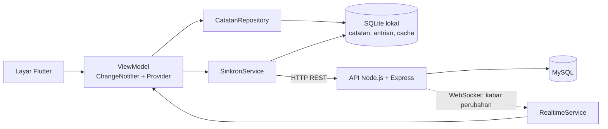
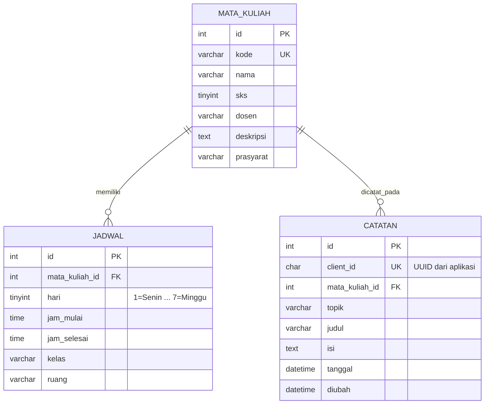

# StudyLog — Aplikasi Catatan Perkuliahan

Aplikasi Android (Flutter) untuk mencatat materi kuliah. Catatan disimpan di
perangkat (SQLite) sehingga tetap bisa dipakai tanpa koneksi, lalu disinkronkan
ke database MySQL lewat API Node.js. Perubahan dari perangkat lain muncul
secara real-time lewat WebSocket.

Proyek PjBL mata kuliah **Pemrograman Aplikasi Bergerak** — Universitas Mulia,
Program Studi Informatika. Mengikuti *Workbook Praktikum 1: StudyLog* (M1–M3)
dengan pengembangan mandiri di bagian [Fitur pengembangan](#fitur-pengembangan-pjbl).

| |                                               |
|---|-----------------------------------------------|
| Nama / NIM | Yuda Pratama Putra / 2411009                  |
| Kelas | IFB5J                                         |
| Repository | `https://github.com/2411009-yuda/studylog-v2` |
| Perangkat uji | `Poco X3 GT`                                  |

> Fitur **Profil Mahasiswa** dari proyek sebelumnya tetap ada sebagai menu
> lain (tab Profil, Mata Kuliah, dan Kontak).

---

## Daftar isi
1. [Fitur](#fitur)
2. [Arsitektur](#arsitektur)
3. [Struktur repository](#struktur-repository)
4. [Menjalankan proyek](#menjalankan-proyek)
5. [Database](#database)
6. [API dan WebSocket](#api-dan-websocket)
7. [Pengujian](#pengujian)
8. [Keputusan desain dan batasan](#keputusan-desain-dan-batasan)
9. [Pemecahan masalah](#pemecahan-masalah)
10. [Riwayat milestone](#riwayat-milestone)
11. [Kontribusi anggota](#kontribusi-anggota)
12. [Dokumentasi bukti](#dokumentasi-bukti)

---

## Fitur

### Inti (sesuai workbook)
- **Form catatan** dengan validasi (mata kuliah, topik minimal 3 karakter, judul, isi).
- **Navigasi multi-layar**: Beranda → Daftar → Detail → Form, dengan tombol kembali yang benar.
- **CRUD catatan**: tambah, lihat, ubah, hapus (dengan dialog konfirmasi).
- **Penyimpanan permanen**: data bertahan setelah aplikasi ditutup dan dibuka ulang.

### Fitur pengembangan (PjBL)
| Fitur | Keterangan | Tingkat di workbook |
|---|---|---|
| **Tiga tabel relasional** | `mata_kuliah`, `jadwal`, `catatan` di MySQL; mata kuliah dan jadwal dibaca dari database | Lanjutan |
| **Urutkan catatan** | Terbaru, Terlama, Judul A–Z; tetap berlaku setelah data dimuat ulang | Dasar |
| **Ekspor teks** | Salin atau bagikan (menu share Android) satu catatan atau semua catatan, mengikuti urutan yang dipilih | Lanjutan |

### Tambahan di luar workbook
- **Tombol + di tengah bottom bar**: membuka form catatan baru dengan mata kuliah **terisi otomatis dari jadwal hari ini** (kelas yang sedang berlangsung; jika tidak ada, kelas yang baru selesai; lalu kelas berikutnya hari itu). Pengguna tetap bisa menggantinya.
- **Offline-first dengan antrian**: simpan, ubah, dan hapus saat offline masuk antrian, lalu terkirim otomatis begitu server terjangkau. Catatan yang belum terkirim diberi tanda awan.
- **Real-time (WebSocket)**: catatan yang dibuat, diubah, atau dihapus di perangkat lain muncul tanpa menekan apa pun. Sambung ulang otomatis, dengan polling cadangan bila WebSocket tidak tersedia.
- **Cache mata kuliah dan jadwal** agar dropdown dan tombol + tetap berfungsi saat offline.
- **Kartu jadwal di Beranda**: kelas yang sedang berlangsung atau berikutnya.

### Menu lain (proyek profil mahasiswa)
Bottom bar: **Beranda · Profil · [+] · Mata Kuliah · Kontak**. Profil dapat diedit (nama, program studi, foto).

---

## Arsitektur



**Alur tanggung jawab** (mengikuti workbook, dengan SQLite sebagai cache lokal):

| Lapisan | Berkas | Tugas |
|---|---|---|
| UI | `screens/`, `widgets/` | Menampilkan state, meneruskan aksi pengguna |
| ViewModel | `viewmodels/` | State layar (`ChangeNotifier`), memicu sinkronisasi |
| Repository | `data/catatan_repository.dart` | Membaca/menulis catatan **hanya ke SQLite**, mencatat perubahan ke antrian |
| Penyimpanan lokal | `data/sqlite_local_store.dart` | Tabel `catatan`, `antrian`, `cache` di perangkat (pengganti `DatabaseHelper` workbook) |
| Sinkronisasi | `data/sinkron_service.dart` | Mengirim antrian ke API, lalu menarik data server dan menyatukannya |
| API client | `data/api_client.dart` | HTTP JSON, timeout, penerjemahan error |
| Real-time | `data/realtime_service.dart` | Mendengarkan kabar WebSocket, sambung ulang bertahap |

**Mengapa aplikasi tidak langsung ke MySQL?** Aplikasi Android tidak dapat terhubung ke
MySQL secara langsung dan aman (kredensial akan ada di aplikasi). Karena itu aplikasi
berbicara ke API Node.js, dan hanya API yang memegang kredensial database.

**Prinsip sinkronisasi**
- Setiap catatan punya `clientId` (UUID) dari aplikasi. Server mengenali kiriman ulang
  dengan `clientId` yang sama, sehingga **tidak membuat catatan ganda** bila balasan hilang.
- Hanya **satu entri antrian per catatan**; perubahan baru menggantikan yang lama.
- Pesan WebSocket hanya *pemberitahuan*. Aplikasi menanggapinya dengan menarik data lewat
  jalur sinkronisasi biasa, dan selalu menarik ulang saat tersambung kembali, sehingga
  kabar yang terlewat tidak membuat data tertinggal.

---

## Struktur repository

```
study_log_app/
├── lib/
│   ├── main.dart
│   ├── app/            # StudyLogApp, router, route, tema
│   ├── config/         # alamat API & WebSocket
│   ├── data/           # api_client, sqlite_local_store, repository, sinkron, realtime
│   ├── models/         # Catatan, Course, Jadwal, Student
│   ├── screens/        # beranda, daftar, detail, form, profil, mata kuliah, kontak
│   ├── services/       # ekspor teks (clipboard + share)
│   ├── utils/          # validator, jadwal, urutan, ekspor, uuid
│   ├── viewmodels/     # CatatanViewModel, MataKuliahViewModel, ProfileViewModel
│   └── widgets/        # banner sinkronisasi, indikator real-time, dll.
├── test/               # tes Flutter (model, ViewModel, sinkronisasi, alur layar)
├── studylog_api/       # server Node.js + MySQL (lihat studylog_api/README.md)
│   ├── db/schema.sql
│   ├── src/            # app, hub (WebSocket), validators, migrasi
│   └── test/
├── pubspec.yaml
└── README.md
```

---

## Menjalankan proyek

### Prasyarat
- Flutter SDK stabil (cek dengan `flutter doctor`), Android SDK, dan emulator atau HP Android.
- Node.js 18 atau lebih baru dan MySQL (atau MariaDB) yang sedang berjalan.
- Git.

### 1. Jalankan server (wajib lebih dulu)
```bash
cd studylog_api
cp .env.example .env        # Windows PowerShell: Copy-Item .env.example .env
# isi DB_USER dan DB_PASSWORD di .env sesuai MySQL-mu
npm install
npm run db:init             # membuat database, tabel, dan data awal
npm start
```
Server siap bila log menampilkan:
```
StudyLog API berjalan di http://localhost:3000/api
Real-time (WebSocket) di ws://localhost:3000/ws
```
Uji cepat: buka `http://localhost:3000/api/mata-kuliah` di browser.

`npm run db:init` aman diulang dan **aman untuk database lama**: catatan tidak dihapus, dan kolom
`client_id` ditambahkan otomatis bila belum ada.

### 2. Atur Android (sekali saja)
Di `android/app/src/main/AndroidManifest.xml`:
```xml
<uses-permission android:name="android.permission.INTERNET"/>
<application
    android:usesCleartextTraffic="true"
    ... >
```
`usesCleartextTraffic` diperlukan karena server lokal memakai HTTP/WS tanpa TLS.

### 3. Jalankan aplikasi
```bash
flutter pub get
flutter analyze
flutter test
```

Pilih satu cara menghubungkan ke server:

| Perangkat | Perintah |
|---|---|
| **Emulator Android** | `flutter run` (alamat bawaan `http://10.0.2.2:3000`) |
| **HP via USB** | `adb reverse tcp:3000 tcp:3000` lalu `flutter run --dart-define=API_BASE_URL=http://localhost:3000` |
| **HP via Wi-Fi** | `flutter run --dart-define=API_BASE_URL=http://IP-LAPTOP:3000` (cari IP dengan `ipconfig`; izinkan port 3000 di Windows Firewall) |

> Jangan memakai target Chrome/web: SQLite (`sqflite`) hanya untuk Android.

---

## Database

### MySQL (sumber data utama)


Data awal: 8 mata kuliah dan 8 jadwal semester 5 kelas IFB5J (`studylog_api/db/schema.sql`).

### SQLite (di perangkat)
| Tabel | Isi |
|---|---|
| `catatan` | Salinan lokal catatan: `id` lokal, `client_id`, `server_id` (null sampai terkirim), data catatan |
| `antrian` | Perubahan yang belum terkirim: `op` (`upsert`/`hapus`), `versi`, `percobaan`, `error` |
| `cache` | Daftar mata kuliah dan jadwal terakhir yang berhasil dimuat |

---

## API dan WebSocket

Dokumentasi lengkap ada di [`studylog_api/README.md`](studylog_api/README.md). Ringkasnya:

| Metode | Path | Keterangan |
|---|---|---|
| GET | `/api/health` | Cek server dan koneksi database |
| GET | `/api/mata-kuliah` | Daftar mata kuliah |
| GET | `/api/jadwal` | Jadwal kuliah |
| GET / POST | `/api/catatan` | Daftar / buat catatan |
| GET / PUT / DELETE | `/api/catatan/:id` | Satu catatan |
| PUT | `/api/catatan/klien/:clientId` | Buat atau ubah, **idempoten** (dipakai antrian offline) |
| DELETE | `/api/catatan/klien/:clientId` | Hapus, selalu 204 (idempoten) |

**WebSocket** `ws://HOST:3000/ws`: setiap perubahan catatan disiarkan sebagai
`{"tipe":"catatan","aksi":"dibuat|diubah|dihapus","id":12,"clientId":"…"}`.

---

## Pengujian

### Otomatis
```bash
flutter test            # model, ViewModel, sinkronisasi, alur layar, real-time
cd studylog_api && npm test    # validator dan hub WebSocket
```

| Area | Berkas tes | Yang diuji |
|---|---|---|
| Model | `catatan_model_test.dart` | Round-trip JSON, format tanggal, `copyWith` (tes model dari workbook) |
| Logika jadwal | `jadwal_test.dart` | Pemilihan mata kuliah untuk tombol + (batas jam, hari kosong, lintas pekan) |
| Antrian & sinkronisasi | `sinkron_test.dart` | Kirim, ubah sebelum kirim, hapus, balasan hilang tanpa duplikat, perubahan saat pengiriman, ditolak server, penyatuan data server |
| ViewModel | `view_model_test.dart` | Status sinkronisasi, offline, urutan, cache mata kuliah |
| Alur layar | `catatan_flow_test.dart`, `offline_flow_test.dart`, `navigation_test.dart` | CRUD T1–T7, offline, bottom bar, back stack |
| Urutkan & ekspor | `urutan_ekspor_test.dart`, `urutan_ekspor_flow_test.dart` | Urutan, format teks, salin, bagikan |
| Real-time | `realtime_service_test.dart`, `realtime_flow_test.dart` | Sambung ulang, debounce, polling cadangan, lifecycle |

Server MySQL dan SQLite diganti tiruan di tes (`fake_server.dart`, `in_memory_local_store.dart`),
sehingga **tes otomatis tidak membuktikan** lapisan SQLite asli dan WebSocket asli. Keduanya
diuji manual di perangkat (lihat matriks di bawah).

### Matriks uji manual di perangkat
Isi kolom hasil setelah mengujinya di HP/emulator.

**M3 — CRUD dan persistensi** (workbook 5.10)

| ID | Skenario | Ekspektasi | Hasil | Catatan |
|---|---|---|---|---|
| T1 Create | Isi form, simpan | Catatan baru muncul | ☐ Lulus ☐ Gagal | |
| T2 Read | Buka daftar dan detail | Data sesuai input | ☐ Lulus ☐ Gagal | |
| T3 Update | Ubah judul, simpan | Data terbaru tampil | ☐ Lulus ☐ Gagal | |
| T4 Delete batal | Hapus lalu Batal | Item tidak dihapus | ☐ Lulus ☐ Gagal | |
| T5 Delete setuju | Hapus lalu konfirmasi | Hanya item terpilih hilang | ☐ Lulus ☐ Gagal | |
| T6 Persistence | Tutup paksa aplikasi, buka lagi | Data masih ada | ☐ Lulus ☐ Gagal | |
| T7 Validasi | Simpan dengan field kosong | Pesan validasi tampil | ☐ Lulus ☐ Gagal | |

**Pengembangan**

| ID | Skenario | Ekspektasi | Hasil | Catatan |
|---|---|---|---|---|
| P1 Tombol + | Tekan + saat jam kuliah | Mata kuliah terisi sesuai jadwal | ☐ Lulus ☐ Gagal | |
| P2 Tombol + | Tekan + di hari tanpa kelas | Dropdown kosong, dipilih manual | ☐ Lulus ☐ Gagal | |
| P3 Urutkan | Pilih Terlama, lalu Judul A–Z | Urutan daftar berubah sesuai pilihan | ☐ Lulus ☐ Gagal | |
| P4 Salin | Ekspor → Salin semua, tempel di aplikasi lain | Teks lengkap dan berurutan | ☐ Lulus ☐ Gagal | |
| P5 Bagikan | Detail → Bagikan | Menu share Android terbuka | ☐ Lulus ☐ Gagal | |
| P6 Offline | Mode pesawat: tambah, ubah, hapus catatan | Tersimpan lokal, tanda awan dan pita offline muncul | ☐ Lulus ☐ Gagal | |
| P7 Sinkron | Nyalakan koneksi | Antrian terkirim; data muncul di MySQL | ☐ Lulus ☐ Gagal | |
| P8 Real-time | Dua perangkat: ubah di A | B berubah tanpa menekan apa pun | ☐ Lulus ☐ Gagal | |
| P9 Server mati | Matikan server, nyalakan lagi | Ikon real-time kembali aktif, antrian terkirim | ☐ Lulus ☐ Gagal | |

### Catatan bug dan perbaikan
| Tanggal | Gejala | Penyebab | Perbaikan | Bukti |
|---|---|---|---|---|
| | `[ISI]` | | | |

---

## Keputusan desain dan batasan

**Penyimpangan dari workbook (dan alasannya)**
- Workbook memakai SQLite saja. Proyek ini memakai **MySQL lewat API Node.js** sebagai sumber data
  utama dan **SQLite sebagai penyimpanan lokal + antrian**. `DatabaseHelper` digantikan `ApiClient`
  dan `SqliteLocalStore`; lapisan Repository → ViewModel → UI tetap.
- Tema workbook adalah "tanpa internet". Proyek ini tetap bisa dipakai offline, tetapi
  **sinkronisasi bergantung pada server yang hidup**. `[ISI jika sudah dikonfirmasi: disetujui dosen pada ...]`

**Batasan yang diketahui**
- **Tidak ada login.** Semua perangkat yang terhubung ke server yang sama berbagi satu kumpulan catatan.
- **Konflik**: bila satu catatan diubah di dua perangkat, yang tiba terakhir menang (*last write wins*).
- **Pertama kali dibuka tanpa koneksi** (belum pernah online sama sekali): mata kuliah belum ada,
  sehingga catatan baru belum bisa dibuat. Aplikasi menampilkan pesan dan tombol *Coba lagi*.
- **Meng-uninstall aplikasi** sebelum antrian terkirim menghilangkan perubahan yang belum tersinkron
  (antrian tersimpan di SQLite perangkat).
- Pilihan urutan belum disimpan permanen (kembali ke *Terbaru* saat aplikasi dibuka ulang).
- Perubahan buatan sendiri juga memantul sebagai kabar WebSocket dan memicu satu penarikan data
  tambahan. Tidak menimbulkan duplikat, hanya satu request ekstra.
- **Keamanan**: API belum memakai autentikasi, CORS terbuka, dan HTTP/WS tanpa TLS. Layak untuk demo
  di jaringan lokal; **jangan dipublikasikan ke internet apa adanya**.
- SQLite hanya berjalan di Android/iOS, bukan web.

---

## Pemecahan masalah

| Gejala | Penyebab umum | Tindakan |
|---|---|---|
| `adb` tidak dikenali | `platform-tools` belum masuk PATH | Panggil lengkap: `& "$env:LOCALAPPDATA\Android\Sdk\platform-tools\adb.exe" devices`, atau tambahkan ke PATH |
| `Cannot find module 'ws'` | Paket belum dipasang setelah file diganti | `npm install` di folder `studylog_api` |
| `EADDRINUSE ... 3000` | Server lama masih berjalan | `Get-NetTCPConnection -LocalPort 3000 -State Listen`, lalu `Stop-Process -Id <PID> -Force` |
| Aplikasi: "perubahan ditolak server: Endpoint tidak ditemukan" | Server yang berjalan masih versi lama | Pastikan `src/app.js` memuat `klien`, jalankan `npm run db:init`, restart server |
| "Tidak dapat terhubung ke server" di HP | Alamat salah, `adb reverse` hilang, firewall | Ulangi `adb reverse`, atau cek IP dan Firewall untuk mode Wi-Fi |
| Ikon real-time terputus tetapi data tetap masuk | WebSocket diblokir, polling cadangan aktif (20 detik) | Cek firewall/jaringan; fungsi lain tetap berjalan |
| `No devices found` | Emulator mati / USB debugging belum aktif | Jalankan emulator, cek `flutter devices` |
| Data hilang setelah restart | Memakai checkpoint M2 | Pastikan kode M3 yang berjalan |

---

## Riwayat milestone

| Milestone | Isi | Pesan commit |
|---|---|---|
| M1 | Form interaktif, validasi, `setState`, SnackBar | `M1: formulir interaktif` |
| M2 | Multi-layar, Navigator, `ChangeNotifier`/Provider (data di memori), bottom bar | `M2: navigasi dan state` |
| M3 | MySQL via API Node.js, SQLite lokal, antrian offline, mata kuliah dan jadwal dari database, tombol +, urutkan, ekspor teks, real-time WebSocket | `M3: ...` |

---

## Kontribusi anggota

| Nama / NIM | Peran | Kontribusi utama |
|---|---|---|
| Yuda Pratama Putra / 2411009 | `[ISI]` | `[ISI: mis. UI, API, sinkronisasi, pengujian]` |
| `[ISI jika berkelompok]` | | |

---

## Dokumentasi bukti

Simpan gambar di folder `docs/` lalu tautkan di sini.

| Bukti | Berkas |
|---|---|
| Beranda | `docs/beranda.png` |
| Daftar catatan (dengan pita offline dan tanda awan) | `docs/daftar.png` |
| Form catatan (mata kuliah terisi otomatis) | `docs/form.png` |
| Detail catatan | `docs/detail.png` |
| Dialog konfirmasi hapus | `docs/hapus.png` |
| Hasil `flutter analyze` dan `flutter test` | `docs/hasil-test.png` |
| Data di tabel `catatan` MySQL | `docs/mysql.png` |
| Video demo 3–5 menit (CRUD, restart, offline, real-time) | `[ISI: tautan]` |

---

## Referensi
- Workbook *Flutter Android — StudyLog* (Praktikum 1), Universitas Mulia, 2026.
- Flutter Docs: [Persist data with SQLite](https://docs.flutter.dev/cookbook/persistence/sqlite),
  [Navigation basics](https://docs.flutter.dev/cookbook/navigation/navigation-basics),
  [Simple app state management](https://docs.flutter.dev/data-and-backend/state-mgmt/simple).
